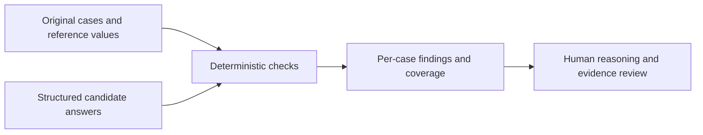

# Engineering AI Answer Evaluator

**A transparent evaluation harness for structured civil-engineering answers.**

A plausible answer can still contain a unit error, invent missing inputs or cite an unsupported
standard. This demo separates checks that can be automated from judgments that require a reviewer.

**Portfolio demo · 12 original synthetic cases · no API key · no model-performance claim**

## Try the example

```sh
python3 evaluate.py data/cases.jsonl examples/synthetic_answers.jsonl --out reports
```

The authored answer fixture deliberately mixes correct answers and errors. It exercises equivalent
units, numerical mistakes, unnecessary or missing abstention, unknown citations and empty reasoning.
[Read the generated report](examples/expected/report.md) and [dataset card](DATASET_CARD.md).
The output is a test of the evaluator, not a score achieved by a named AI model.



## What is checked

| Signal | Implemented check | What it does not prove |
|---|---|---|
| Numerical result | Unit normalization and absolute/relative tolerance | Sound reasoning or valid design inputs |
| Abstention | Missing-information cases require no numeric result | Whether the explanation asks the right questions |
| Citation identifiers | Nonempty list, all IDs on the case allowlist | Source existence outside the fixture or entailment |
| Reasoning | Nonempty text | Correct logic, completeness or safety |
| Coverage | Missing answers count as failures in the full denominator | Broad capability on unseen tasks |

A structural pass is never engineering approval. Every answer is marked `human_review_required`.
One test intentionally proves that a wrong rationale can pass the narrow automated checks.
The reviewer must use [the rubric](HUMAN_REVIEW.md) to catch that failure mode.

## Data contract

Files are JSONL: one JSON object on each line, with exactly the documented fields.
Cases contain `id`, `split`, `prompt`, `kind`, `expected_value`, `expected_unit`, `abs_tolerance`,
`rel_tolerance`, `allowed_source_ids`, and `reference_reasoning`.
`kind` is `numeric` or `abstain`; `split` is `development` or `holdout`.

Answers contain `id`, `value`, `unit`, `abstain`, `source_ids`, and `reasoning`.
For abstention, use `value: null`, `unit: null`, `abstain: true`.
Duplicate or unknown answer IDs are errors. Missing IDs remain in the denominator. An empty answer
file is valid and scores zero coverage. Invalid JSON or non-finite values stop the run.

Supported units are exactly `m3/s`, `L/s`, `m3`, `m2`, `ha`, `m`, `mm`, with dimensional checks.
The tolerance is `max(abs_tolerance, abs(expected_value) × rel_tolerance)` in the expected unit.
The default fixtures use 0.001 relative tolerance (0.1%) and 0.000001 absolute tolerance.
These are arithmetic test tolerances, not design acceptance criteria.

## Evaluating a real candidate later

Use [the candidate prompt](prompts/candidate_prompt.txt), supplying only case `id` and `prompt`
plus the source pack; keep reference answers and rubrics out of the candidate context. Save the
structured responses in a separate file and run the same evaluator. Record model identifier,
configuration, prompt version, run date, errors and human ratings using the supplied templates.
This release does not call a model, store credentials, or include actual model output.

The public holdout is only a demonstration of split reporting. It is small, related to the
development cases, and fully visible. It cannot support a generalization claim. For a real experiment,
create a fresh private evaluation set and freeze it before tuning.

## Trust and reproducibility

All included data is synthetic. This is an AI-assisted portfolio demo, not an employment project
or production system. See [provenance](PROVENANCE.md) and the [MIT license](LICENSE).
Input hashes in `report.json` identify the exact files used. Examples are deterministic and run offline.
The code uses Python's standard library; no API key, paid service or additional package is needed.

Run from this repository's folder using Python 3.9 or newer. The supplied version was locally tested
on Python 3.9.6. A GitHub Actions workflow is included for Python 3.11 and 3.13; hosted runs are not
claimed until the repository is uploaded and those checks run.

```sh
python3 -m unittest discover -s tests -v
```

On Windows, use `py -3` in place of `python3`. On systems where Python 3 is named `python`, use that.
Output folders contain `report.md` for reading and `report.json` for further analysis.
Normal execution returns 0 after generating a report; `--fail-on-findings` returns 1 when review is
needed. Invalid input or an output error returns 2. JSONL fields are validated, numbers must be finite, and duplicate identifiers are rejected.

## Explain it in an interview

Walk through one input, show a deliberate error, explain the result, and describe what the tool
cannot establish. The value is a reproducible review process with visible assumptions.
Do not claim production use, savings, compliance approval or independent authorship of AI-assisted work.
